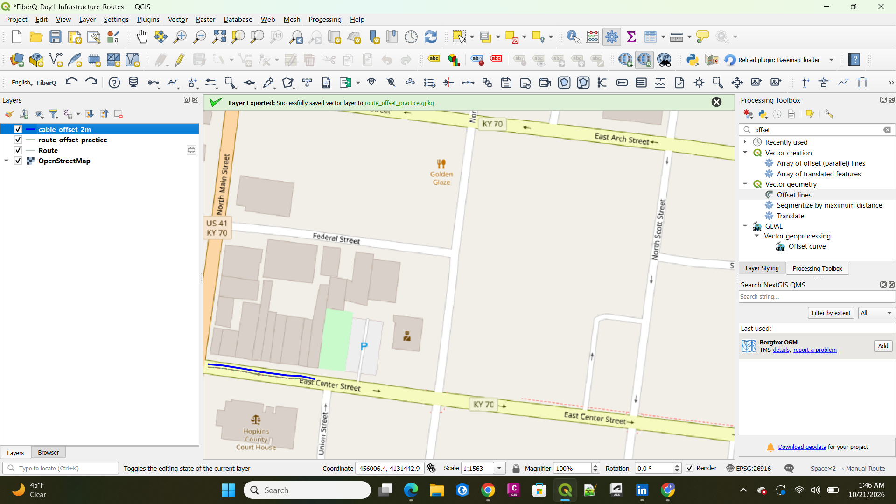
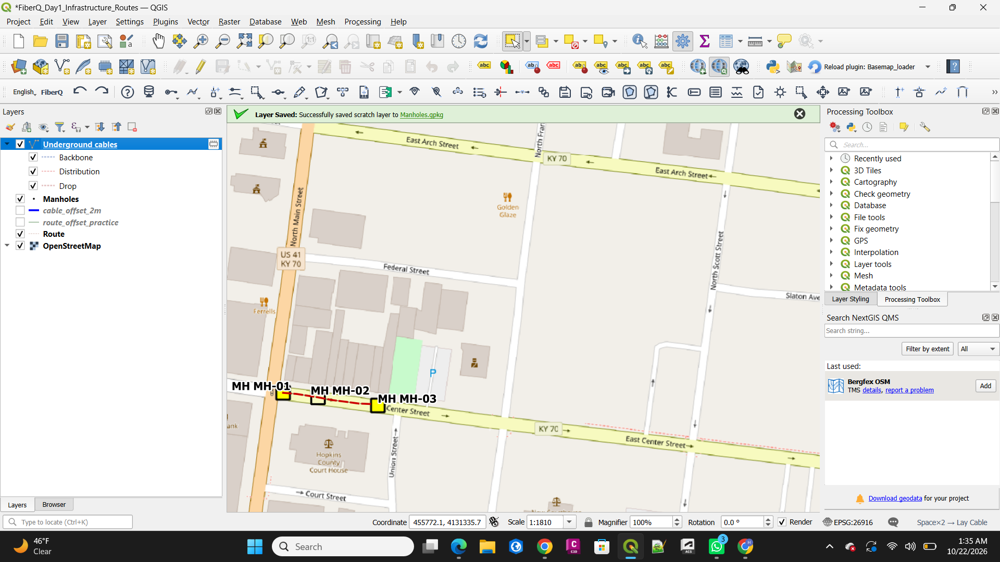
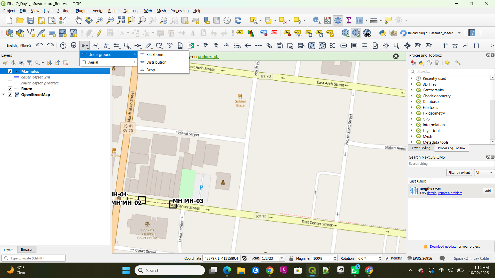
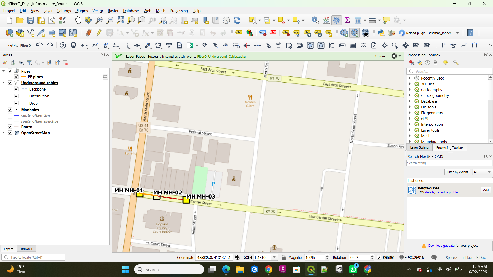
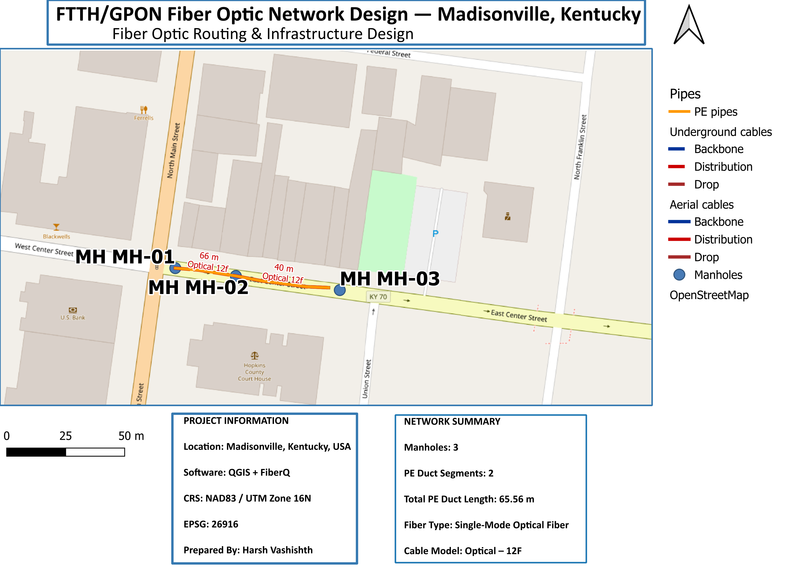

# FTTH/GPON Fiber Optic Network Design | Madisonville, Kentucky

**A conceptual fiber-optic network planning and infrastructure mapping project using QGIS and the FiberQ plugin.**

> **Portfolio project / training exercise:** The network is illustrative and has not been surveyed, field-verified, or approved for construction.

## Project Overview

This project demonstrates a basic Fiber-to-the-Home (FTTH) / Gigabit Passive Optical Network (GPON) design workflow for a small practice area along East Center Street in **Madisonville, Kentucky, USA**.

Using QGIS and FiberQ, I mapped a route, placed manholes, created polyethylene (PE) duct segments, laid optical fiber cables, inspected network attributes, and generated a schematic and bill-of-materials (BOM) preview.

## Tools and Spatial Reference

- **GIS Software:** QGIS
- **Network Design Plugin:** FiberQ
- **Basemap:** OpenStreetMap
- **Coordinate Reference System:** NAD83 / UTM Zone 16N (EPSG:26916)
- **Output Formats:** QGIS project, GeoPackage, PNG, schematic visualization, and optional BOM CSV/XLSX

## Project Workflow

### 1. Project Setup and Infrastructure Routing

- Installed and configured the FiberQ plugin in QGIS.
- Set the project CRS to EPSG:26916.
- Added OpenStreetMap as the reference basemap.
- Created an infrastructure route along East Center Street.
- Inspected and edited route geometry.



### 2. Cable Offset and Underground Fiber Routing

- Generated offset geometry for the infrastructure route.
- Practiced positioning fiber cables relative to the route.
- Created underground optical cable connections.
- Reviewed cable attributes and network connectivity.



### 3. Manhole Placement and Attribute Management

Created three manholes along the planned fiber network:

- MH-01
- MH-02
- MH-03

Configured and inspected manhole IDs, construction types, installation status, and other available attributes.



### 4. PE Pipe and Duct Network Design

Designed two polyethylene duct segments connecting the manholes.

- **Duct Material:** PE
- **Duct Capacity:** 1×1
- **Diameter:** 40 mm
- **Total Duct Length:** Approximately 65.56 m



### 5. Optical Cable Design and Network Visualization

- Practiced underground and aerial fiber cable routing.
- Used an Optical – 12F single-mode cable model.
- Inspected cable length, fiber count, installation type, and connectivity.
- Reviewed the FiberQ optical schematic.
- Generated a bill-of-materials preview.

### 6. Final Network Map and Cartographic Layout

Created a professional QGIS map layout featuring:

- Network routing and infrastructure
- Manhole locations
- PE duct segments
- Fiber cable symbology
- Legend and north arrow
- Scale bar
- Coordinate reference system
- Project information and network summary



## Network Summary

| Component | Details |
|---|---|
| Project Location | Madisonville, Kentucky, USA |
| Manholes | 3 |
| PE Duct Segments | 2 |
| Total PE Duct Length | 65.56 m |
| PE Duct Diameter | 40 mm |
| Duct Capacity | 1×1 |
| Optical Cable Model | Optical – 12F |
| Fiber Type | Single-mode |
| Example Aerial Cable Span | MH-02 to MH-03, approximately 39.68 m |
| Project CRS | EPSG:26916 |
| Design Status | Planned / Conceptual |

*The underground and aerial cables were used for routing practice and may represent alternative design exercises. Their lengths should not automatically be combined as a single deployed network.*

## Repository Structure

```text
ftth-gpon-fiber-network-qgis-fiberq/
├── README.md
├── maps/
│   └── FTTH_GPON_Fiber_Network_Design_Madisonville_KY.png
├── screenshots/
│   ├── Route_fiberq.png
│   ├── Underground_cables.png
│   ├── Manholes.png
│   └── Pipes.png
├── data/
│   └── QGIS project and GeoPackage files (to be added)
└── docs/
    └── BOM reports (optional)
```

## Technical Skills Demonstrated

- QGIS project setup and coordinate reference systems
- FiberQ network design workflows
- Infrastructure route digitization
- Cable offset and geometry processing
- Manhole placement and attribute management
- PE duct and pipe network modeling
- Underground and aerial fiber routing
- Optical network schematic visualization
- Bill-of-materials review
- GIS cartography and map layout design
- GeoPackage data management

## Reproducing the Project

1. Install QGIS and a compatible version of the FiberQ plugin.
2. Download or clone this repository.
3. Open the QGIS project file once it has been added to the `data/` directory.
4. Reconnect any missing GeoPackage layers if necessary.
5. Inspect the network geometry, attributes, and cartographic outputs.

**Project limitations:** This is a GIS training project, not a construction-ready telecommunications engineering design. It does not include a verified optical loss budget, complete customer drop design, field survey, or engineering approval.

## Author

**Harsh Vashishth**

- **GitHub:** https://github.com/harshvashishth-gis-developer
- **GIS Portfolio:** https://harshvashishth-gis-developer.github.io/

## Attribution

Basemap data: © OpenStreetMap contributors.

All network infrastructure shown in this project is illustrative and intended for GIS and fiber-network design training.
